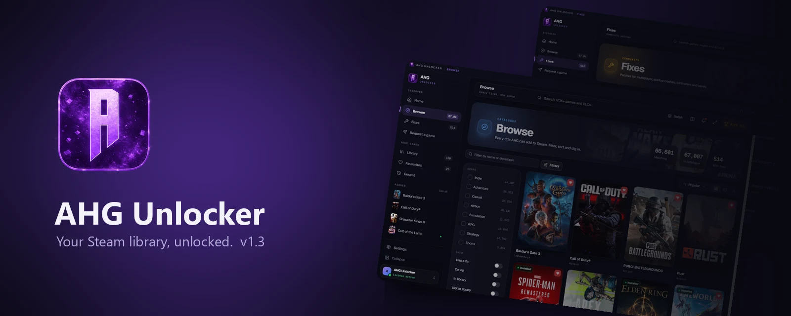
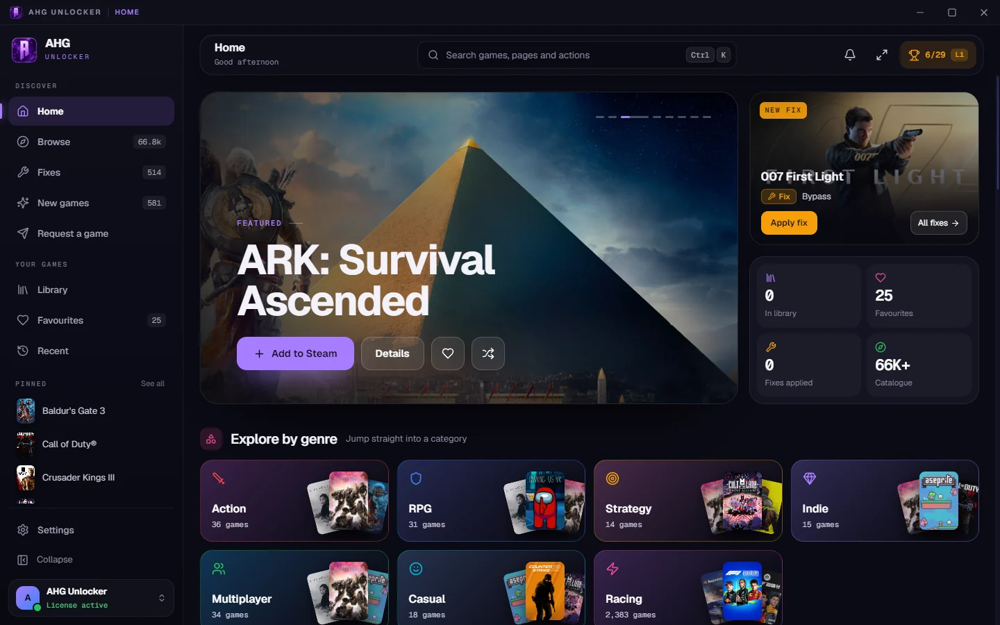
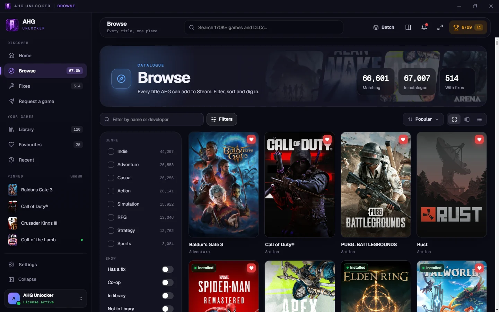
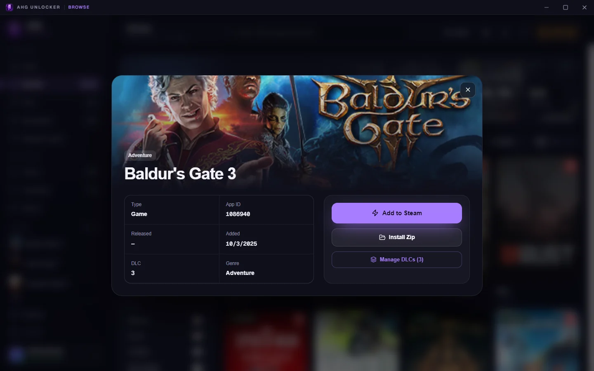
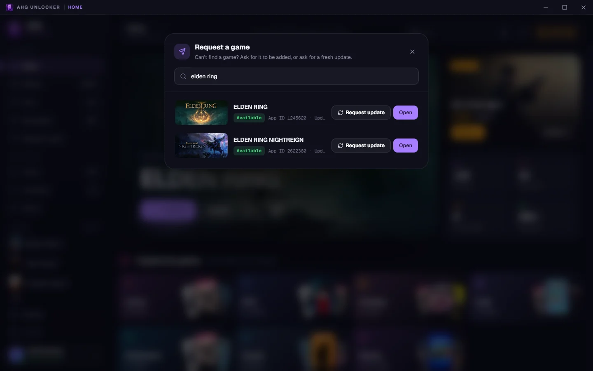
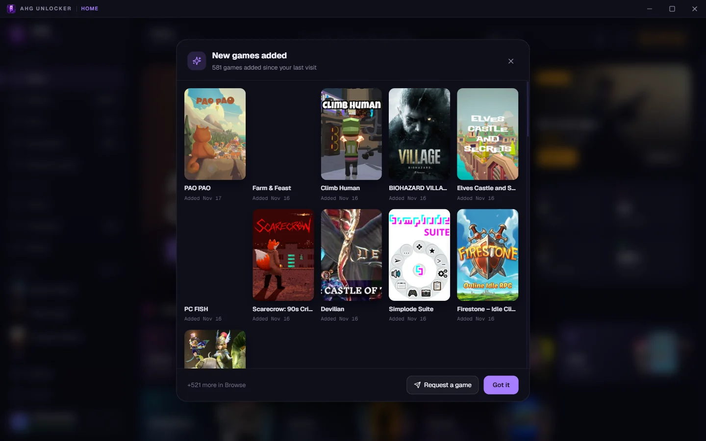
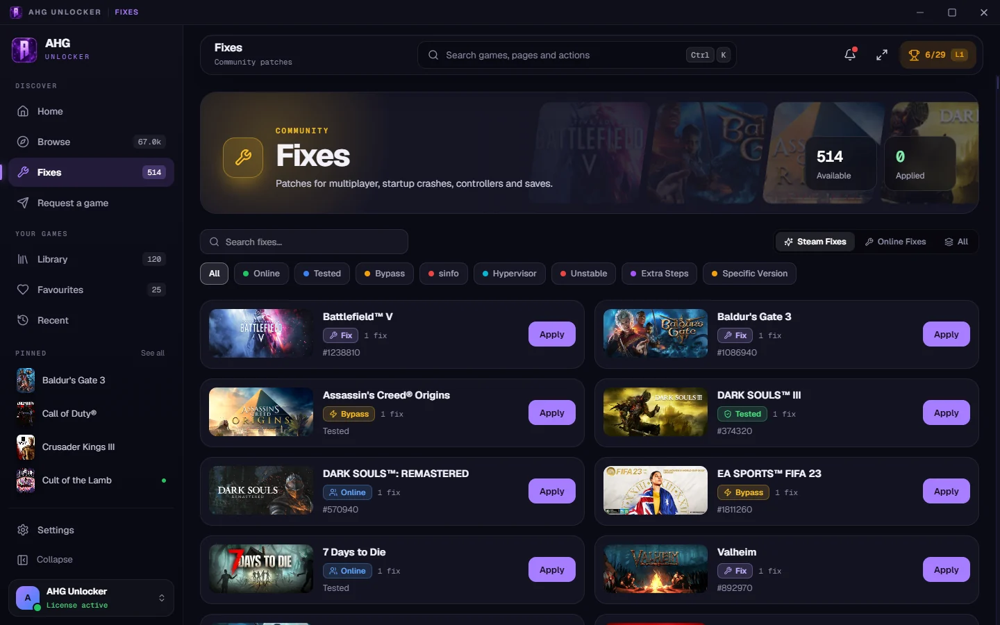
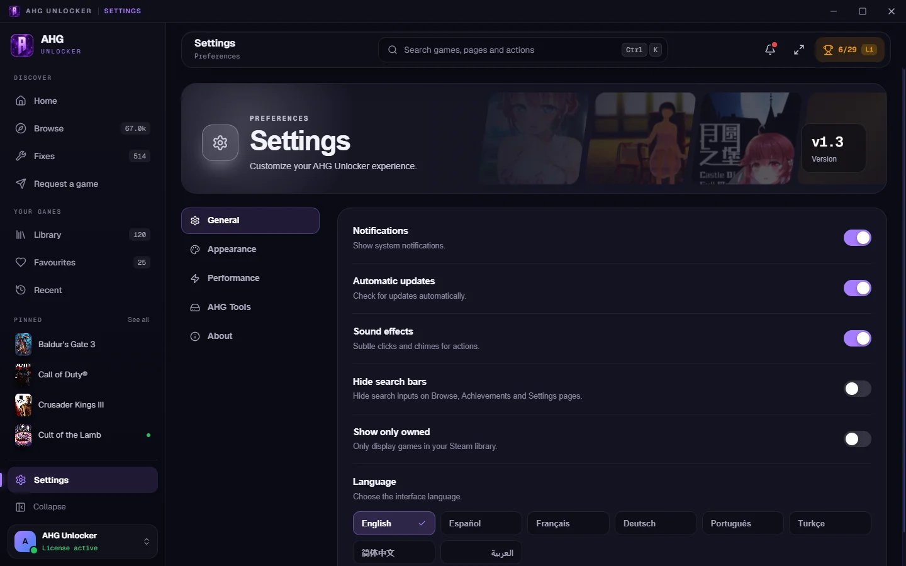
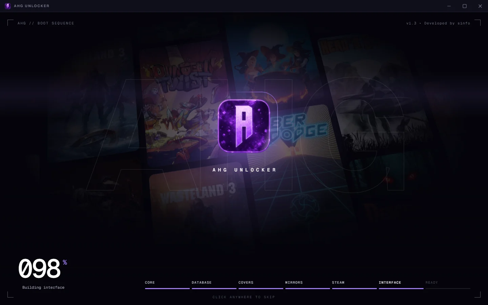
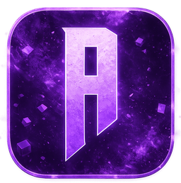

<p align="center">
  
</p>

<p align="center">
  <a href="https://github.com/sinfoo/AHG-Steam-Unlocker/releases/latest"></a>
  
  
  
</p>

<p align="center">
  <b>Browse the catalogue, add a game to Steam in one click, apply fixes, and ask for the games that are missing.</b>
</p>

<p align="center">
  <a href="https://github.com/sinfoo/AHG-Steam-Unlocker/releases/latest/download/AHG-Unlocker-Setup.exe"><b>Download AHG Unlocker</b></a>
  &nbsp;·&nbsp;
  <a href="#whats-new-in-13">What's new</a>
  &nbsp;·&nbsp;
  <a href="#install">Install</a>
  &nbsp;·&nbsp;
  <a href="#for-developers">Developers</a>
</p>

---

<p align="center">
  
</p>

## Features

| | |
|---|---|
| **67,000+ games** | Search, filter by genre and sort the whole catalogue, with covers, DLC counts and "installed" badges. |
| **One-click add to Steam** | Pick a game and AHG adds it to your Steam library. Its DLC are one more click. |
| **500+ fixes** | Community fixes for multiplayer, crashes on start and controllers, applied from inside the app. |
| **Request a game** | Can't find something? Search Steam by name, App ID or store link and request it, or ask for a fresh update. |
| **New games, every launch** | AHG shows what was added since your last visit. |
| **Your library** | Installed games, updates waiting and fixes applied, in one place. Favourites pin to the sidebar. |
| **Updates itself** | New versions install in the background through AHG Setup. |
| **8 languages** | English, Español, Français, Deutsch, Português, Türkçe, 简体中文, العربية. |

## A look inside

<table>
  <tr>
    <td width="50%"><p align="center"><sub><b>Browse</b>: the full catalogue, filters and sorting</sub></p></td>
    <td width="50%"><p align="center"><sub><b>Game page</b>: add to Steam, DLC and fixes</sub></p></td>
  </tr>
  <tr>
    <td width="50%"><p align="center"><sub><b>Request a game</b>: search Steam, see what's available, request the rest</sub></p></td>
    <td width="50%"><p align="center"><sub><b>New games</b>: everything added since your last visit</sub></p></td>
  </tr>
  <tr>
    <td width="50%"><p align="center"><sub><b>Fixes</b>: community patches, one click to apply</sub></p></td>
    <td width="50%"><p align="center"><sub><b>Settings</b>: appearance, performance, language</sub></p></td>
  </tr>
</table>

<p align="center">
  <br>
  <sub>The boot sequence</sub>
</p>

## What's new in 1.3

- **Request a game**: search any Steam game by name, App ID or store link. See whether it's already available, then request it or ask for a fresh update. Your requests and their status are listed below the search.
- **New games since your last visit**: each launch shows the games added since you last opened AHG, with a count in the sidebar.
- **Not found? Request it**: a search with no results now offers to request the game.
- **Faster setup download**: AHG Setup downloads in parallel pieces, so one slow connection no longer caps the speed.

[Full release notes →](https://github.com/sinfoo/AHG-Steam-Unlocker/releases/latest)

## Install

1. Download **[`AHG-Unlocker-Setup.exe`](https://github.com/sinfoo/AHG-Steam-Unlocker/releases/latest/download/AHG-Unlocker-Setup.exe)** and run it.
2. Pick a folder (or keep the default) and click **Install**. Setup downloads the latest version and checks its checksum before installing.
3. Open AHG Unlocker and enter your license key. Dashes are optional.

Already on 1.2.8? The app updates itself. Older versions: run the setup once; games, favourites and settings are kept.

Prefer a portable copy? Download the `.zip` from the [latest release](https://github.com/sinfoo/AHG-Steam-Unlocker/releases/latest) and run `AHG Unlocker.exe`.

> Windows SmartScreen may warn about an unknown publisher because the files are not code-signed yet. Click **More info → Run anyway**.

---

## For developers

<p>
  
  Electron 33 + React 19 + TypeScript + Vite + Tailwind CSS. The renderer talks to the main process only through <code>electron/preload.cjs</code> and the typed wrapper in <code>src/bridge.ts</code>.
</p>

| Layer | Technology |
|---|---|
| Desktop shell | Electron 33 (main process in `electron/`, IPC handlers in `electron/handlers/`) |
| UI | React 19, TypeScript, Tailwind CSS 4, Framer Motion |
| State | Zustand stores in `src/store/` |
| Catalogue | SQLite (sql.js) synced from the Ryuu game list, searched in a Web Worker |
| Lists | `@tanstack/react-virtual` |
| Covers | Disk cache served through the `image-cache://` protocol |
| Installer | MSI (electron-builder) + AHG Setup (`installer/setup`, .NET Framework 4.8) |

```bash
npm install          # dependencies
npm run dev          # Vite dev server
npm run typecheck    # tsc --noEmit
npm run build        # type check + production renderer build
npm run lint

# Tests
node --test electron/handlers/__tests__/*.test.cjs src/utils/__tests__/*.test.cjs

# Unpacked Windows build in dev-release/
node scripts/sync-main.js
npx electron-builder --win --dir --config.win.signAndEditExecutable=false --config.directories.output=dev-release
```

`config/secrets.json` (gitignored) holds the API keys the packaged app needs; copy `config/secrets.template.json` to start one.

```
src/            React app: pages/, components/, store/, hooks/, workers/, i18n/
electron/       main process: main.cjs, preload.cjs, handlers/, utils/
installer/      AHG Setup (download, verify, install, update)
bot/            Discord license bot
docs/           design tokens (DESIGN.md), product notes, README images
```

## License

Proprietary. Developed by sinfo.
